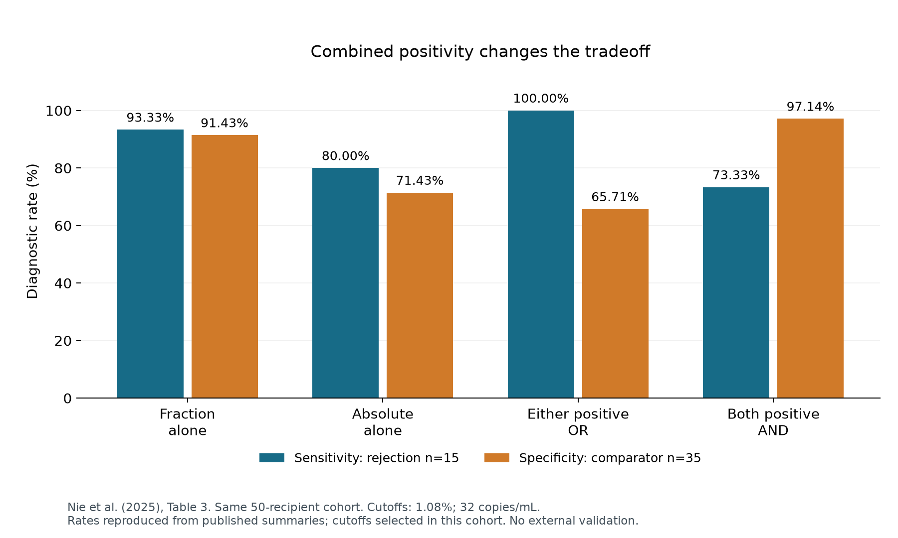
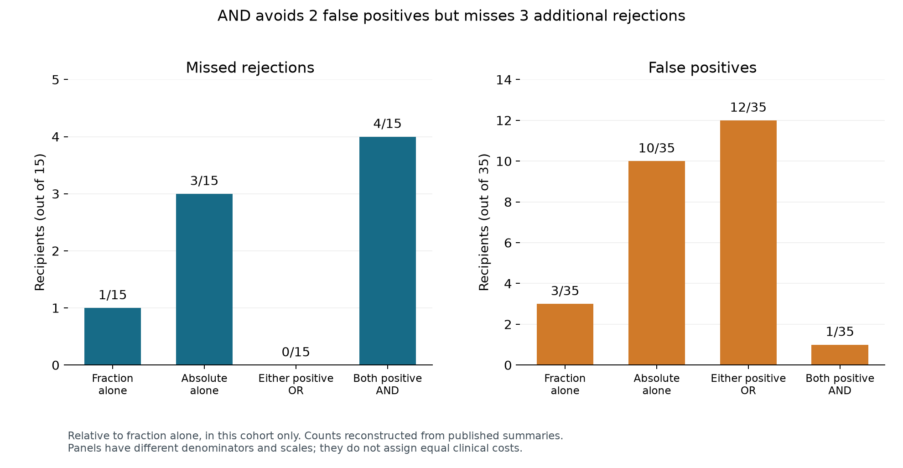
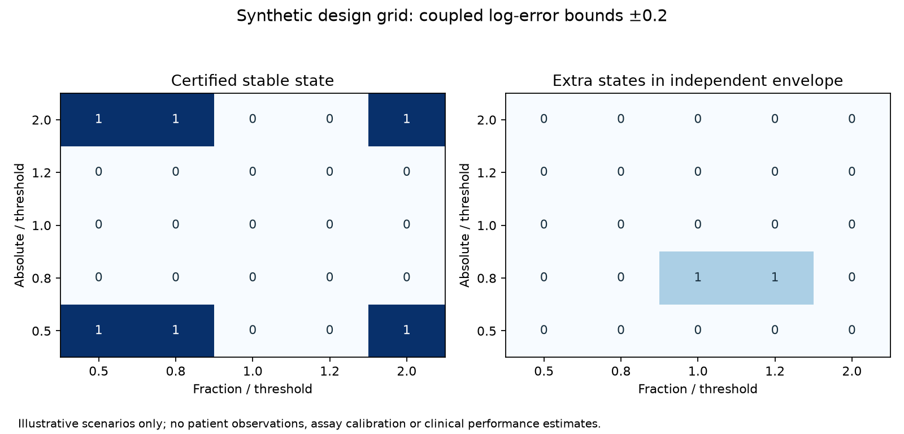

# Kidney dd-cfDNA: diagnostic tradeoffs and classification stability

How does combining two blood-test measurements change the balance between missed kidney-transplant rejection and false-positive results?

This project turns published diagnostic statistics into an interactive comparison of four rules: fractional donor-derived cell-free DNA (dd-cfDNA) alone, absolute dd-cfDNA alone, either measurement positive (OR), and both measurements positive (AND). It combines an educational browser guide, an executed analysis notebook, source summaries, and explanatory figures.

## Guided project walkthrough

Open [the project overview](docs/index.html) in a browser and follow four connected steps: **the question → published evidence → uncertainty explorer → next study**. The uncertainty view includes a live fraction-versus-concentration plot comparing coupled and independent error regions. Published observations, hypothetical experiments and planned analyses have distinct labels throughout.

## Integrated research framework

This project connects three levels of evidence: published-cohort reconstruction, hypothetical uncertainty experiments, and a data-dependent molecular-validation study. The original results below remain the clinical foundation.

**New question:** when fractional and absolute measurements share error, does ignoring that coupling permit impossible discordance states—and are molecular descriptions of discordance reproducible when classification instability is considered?

- [Classification-stability explorer](docs/stability.html): an interactive mathematical demonstration with explicit assumptions.
- [Integrated analysis plan](protocol/ANALYSIS_PLAN.md): endpoints, measurement model, molecular requirements and validation gates.
- [Full research framework](protocol/FRAMEWORK.md) and [novelty/data audit](protocol/NOVELTY_AUDIT.md).
- [Running the analyses](RUNNING.md): reproducible scripts and molecular preparation APIs.

The working extension provides exact bounded-state certification, a coupled-versus-independent comparison, and a 100-point synthetic design grid. It includes patient-separated module scoring and a minimal cluster-bootstrap association estimator. No matched molecular dataset or real molecular association result is included. Clinical validation and publication-level novelty remain open.

## Main finding from published clinical summaries

Requiring **both measurements to be positive** reduces false positives but increases missed rejections compared with fraction alone. Combining measurements changes the diagnostic tradeoff; it does not improve every outcome.

| Diagnostic rule | Missed rejection /15 | False positive /35 | Sensitivity | Specificity |
|---|---:|---:|---:|---:|
| Fraction alone | 1 | 3 | 93.33% | 91.43% |
| Absolute alone | 3 | 10 | 80.00% | 71.43% |
| Either positive (OR) | 0 | 12 | 100.00% | 65.71% |
| Both positive (AND) | 4 | 1 | 73.33% | 97.14% |

**AND avoids two false positives while missing three additional rejections.** OR detects all 15 observed rejection cases while producing 12 false positives. All four rules describe the same cohort.

## Explore the project

- **Interactive guide:** open [the published-evidence view](docs/evidence.html) in a browser to compare rules, inspect sensitivity and specificity, and check your interpretation with a short quiz.
- **Analysis notebook:** [analysis.ipynb](analysis.ipynb) explains the data, count reconstruction, numerical checks, and biological interpretation, with executed results.
- **Figures:** the charts below summarize diagnostic rates and error counts.
- **Evidence and methods:** [source provenance](data/SOURCES.md) documents the original tables and transformations; [interpretation](INTERPRETATION.md) explains what the results mean and where they stop.

*Rates at the source study's selected cutoffs: fraction 1.08% and absolute concentration 32 copies/mL.*

*Error counts reconstructed from published summaries. The panels use different denominators and scales.*

## Evidence and approach

The data come from [Nie et al. (2025), Diagnostics 15:237](https://doi.org/10.3390/diagnostics15030237): 50 kidney-transplant recipients undergoing biopsy, comprising 15 rejection recipients and 35 comparators. Four diagnostic-rule summaries and six phenotype summaries are retained.

For each published sensitivity and specificity, the analysis enumerates integer counts compatible with the reported percentage and cohort denominator. A count is accepted only when the solution is unique. The resulting true-positive, false-negative, true-negative, and false-positive counts reproduce all 16 reported sensitivity, specificity, PPV, and NPV values within rounding. AND/OR set relationships and three rounding tolerances are also checked.

## Why the biology matters

Fractional dd-cfDNA expresses donor DNA relative to total circulating cell-free DNA. Changes in recipient-derived DNA can therefore change the fraction. In this study, absolute dd-cfDNA was calculated from total cfDNA and donor fraction, so the two measurements are mathematically linked. Their agreement or disagreement can inform interpretation, but these aggregate summaries cannot establish the mechanism in an individual patient.

## Context and limits

This educational project accompanies a narrative review on fractional and absolute dd-cfDNA interpretation in kidney transplantation. It makes one question concrete: which diagnostic outcomes change when measurements are combined?

The evidence is one small cohort with cutoffs selected in that cohort. Fourteen of the 15 rejection recipients had ABMR/mixed rejection; only one had TCMR. Borderline TCMR remained in the comparator group. Predictive values depend on the cohort's 30% rejection prevalence. Observed 100% sensitivity does not demonstrate safe biopsy replacement. This is secondary analysis of published aggregate statistics, without patient-level data or independent clinical validation.

## Attribution and reuse

Original measurements and source tables: [Nie W. et al. (2025)](https://doi.org/10.3390/diagnostics15030237), licensed [CC BY 4.0](https://creativecommons.org/licenses/by/4.0/). Transcribed and derived tables retain attribution. Original project code is MIT-licensed; see [LICENSE](LICENSE) and [NOTICE.md](NOTICE.md). Educational analysis; not a patient-care calculator.

## New methodological experiment

When absolute concentration is calculated as donor fraction × total cfDNA, fraction error also changes calculated concentration. The extension preserves this relationship. At coincident normalized thresholds with no total-cfDNA error, coupled fraction error can move both measurements together: the two discordant states are impossible. An independent-error envelope permits them. This exact geometric result illustrates why the measurement model matters; it is not a new clinical observation.

*A fixed design grid under illustrative log-error bounds. It does not estimate instability rates in a patient population.*
